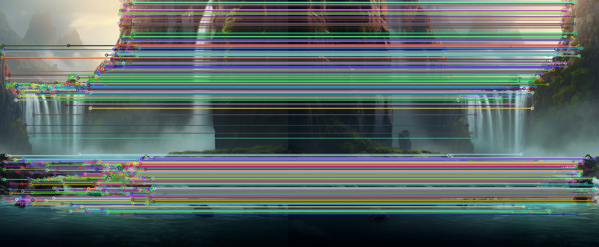

# 实验三：基于 SIFT 特征的图像拼接

## 1. 实验目的

给定两张对同一场景（瀑布）拍摄、存在部分重叠的图片 `left.png`（左图）和 `right.png`（右图），将其拼接为一张宽幅全景图。完整流程包括：

1. 在两张图中检测局部不变特征点；
2. 完成两张图之间的特征匹配；
3. 估计将一张图投影到另一张图坐标系下的几何变换（单应矩阵）；
4. 对其中一张图做透视变换，并将两张图合成为一张全景图。

---

## 2. 实验原理

### 2.1 SIFT（尺度不变特征变换）

SIFT 在高斯差分（DoG）金字塔中检测**尺度空间极值点**，剔除低对比度点和边缘响应点，并为每个关键点生成 128 维的梯度方向直方图描述子。该描述子对图像的平移、缩放、旋转保持不变，对光照变化和小范围视角变化也具有较好的稳定性——这正是跨视角匹配所需的性质。

### 2.2 FLANN 匹配器

直接暴力匹配两组描述子复杂度为 `O(N·M)`。**FLANN（Fast Library for Approximate Nearest Neighbors）** 对参考描述子构建 KD-Tree，并在限定检查次数内近似搜索最近邻，以极小的精度损失换取显著的速度提升。本实验对每个查询描述子取其 **2** 个最近邻（`k=2`）。

### 2.3 Lowe 比率测试

并非所有最近邻匹配都是正确匹配——水面、岩石、植被等重复纹理极易产生歧义匹配。对每一对 `(m, n)`（`m` 为最优匹配，`n` 为次优匹配），仅当

```
distance(m) < 0.7 · distance(n)
```

时才保留 `m`。若二者距离接近，说明该匹配点歧义性大，应予剔除。0.7 是 Lowe 原文推荐的经验阈值。

### 2.4 单应矩阵与 RANSAC

当相机绕光心纯旋转（或场景近似共面）时，两视图之间满足一个 **3×3 的单应矩阵 H**：

```
[x']   [h11 h12 h13] [x]
[y'] = [h21 h22 h23] [y]
[1 ]   [h31 h32 h33] [1]
```

理论上 4 对正确点即可求解 H，但匹配集中仍混有外点。因此采用 **RANSAC（随机抽样一致性）**：反复随机抽取 4 对匹配点估计 H，统计其余匹配点中满足重投影误差（阈值 5 px）的内点数量，保留内点最多的 H，从而对外点具备鲁棒性。

### 2.5 画布平移

将 `right.png` 经 H 变换到 `left.png` 坐标系后，变换后的角点可能出现负坐标或超出原画布范围。因此先计算两图所有角点的外接矩形，构造一个二维平移矩阵，把所有像素平移到正坐标象限，再按 `T · H` 做透视变换，最后把参考图 `left.png` 直接贴回结果画布对应位置。

---

## 3. 实验环境

| 项目 | 版本 |
|---|---|
| Python | 3.x |
| OpenCV | 4.x / 5.x（内置 `cv2.SIFT_create`） |
| NumPy | ≥ 1.20 |

安装依赖：

```bash
pip install opencv-python numpy
```

> 注意：在较旧的 OpenCV 4.x 中 `cv2.SIFT_create()` 需要 `opencv-contrib-python`；较新版本已合并入 `opencv-python`。

---

## 4. 仓库结构

```
.
├── image_stitching.py     # 主程序
├── left.png               # 输入：参考图（左视图）
├── right.png              # 输入：待变换图（右视图）
├── matched_keypoints.png  # 输出：SIFT 匹配连线可视化
├── stitched_result.png    # 输出：拼接后的全景图
└── README.md
```

运行：

```bash
python image_stitching.py
```

---

## 5. 输入图像

**左视图（`left.png`）**——参考图，保持不动：


**右视图（`right.png`）**——待变换图，将被投影到左图坐标系：


两图在中间区域（主瀑布群）存在重叠，为单应矩阵估计提供了充足的对应点。

---

## 6. 完整源代码

```python
# -*- coding: utf-8 -*-
"""
实验三：基于 SIFT 特征的图像拼接
将 left.png 与 right.png 拼接为一张全景图。
"""
import cv2
import numpy as np
import os

# ---------- 0. 路径配置 ----------
OUT_DIR = os.path.dirname(os.path.abspath(__file__))
img_left_path = os.path.join(OUT_DIR, "left.png")    # 参考图（固定不动）
img_right_path = os.path.join(OUT_DIR, "right.png")  # 待变换图


def imread_unicode(path):
    """支持中文路径的 imread（Windows 下 cv2.imread 不支持非 ASCII 路径）"""
    data = np.fromfile(path, dtype=np.uint8)
    return cv2.imdecode(data, cv2.IMREAD_COLOR)


def imwrite_unicode(path, img):
    """支持中文路径的 imwrite"""
    ext = os.path.splitext(path)[1]
    ok, buf = cv2.imencode(ext, img)
    if ok:
        buf.tofile(path)


# ---------- 1. 读图并转灰度 ----------
img_a = imread_unicode(img_left_path)    # img_a：左图
img_b = imread_unicode(img_right_path)   # img_b：右图
gray_a = cv2.cvtColor(img_a, cv2.COLOR_BGR2GRAY)
gray_b = cv2.cvtColor(img_b, cv2.COLOR_BGR2GRAY)
print(f"左图尺寸: {img_a.shape}, 右图尺寸: {img_b.shape}")

# ---------- 2. SIFT 特征检测与描述子计算 ----------
sift = cv2.SIFT_create()
kp_a, des_a = sift.detectAndCompute(gray_a, None)
kp_b, des_b = sift.detectAndCompute(gray_b, None)
print(f"左图关键点数量: {len(kp_a)}, 右图关键点数量: {len(kp_b)}")

# ---------- 3. FLANN knnMatch + Lowe 比率测试 ----------
FLANN_INDEX_KDTREE = 1
index_params = dict(algorithm=FLANN_INDEX_KDTREE, trees=5)
search_params = dict(checks=50)
flann = cv2.FlannBasedMatcher(index_params, search_params)

matches = flann.knnMatch(des_b, des_a, k=2)   # query=右图(b), train=左图(a)

good_matches = []
for m, n in matches:
    if m.distance < 0.7 * n.distance:
        good_matches.append(m)
print(f"经 Lowe 比率筛选后的优质匹配点数量: {len(good_matches)}")

# ---------- 4. 绘制匹配连线图 ----------
matched_img = cv2.drawMatches(
    img_b, kp_b, img_a, kp_a, good_matches, None,
    flags=cv2.DrawMatchesFlags_NOT_DRAW_SINGLE_POINTS
)
imwrite_unicode(os.path.join(OUT_DIR, "matched_keypoints.png"), matched_img)

# ---------- 5. 提取匹配点坐标并估计单应矩阵 H ----------
# src_pts = 右图(b)上的点（待变换）
# dst_pts = 左图(a)上的点（参考）
# findHomography(src, dst) 求的是把 img_b 投影到 img_a 的变换矩阵 H
src_pts = np.float32([kp_b[m.queryIdx].pt for m in good_matches]).reshape(-1, 1, 2)
dst_pts = np.float32([kp_a[m.trainIdx].pt for m in good_matches]).reshape(-1, 1, 2)

H, mask = cv2.findHomography(src_pts, dst_pts, cv2.RANSAC, 5.0)
inliers = int(mask.sum()) if mask is not None else 0
print(f"RANSAC 内点数量: {inliers} / {len(good_matches)}")
print("单应矩阵 H =\n", H)

# ---------- 6. 计算拼接画布尺寸并加入平移 ----------
h_a, w_a = img_a.shape[:2]
h_b, w_b = img_b.shape[:2]

# 右图四个角点经 H 变换后的位置
pts = np.float32([[0, 0], [0, h_b], [w_b, h_b], [w_b, 0]]).reshape(-1, 1, 2)
dst_corners = cv2.perspectiveTransform(pts, H)

# 与左图四个角点合并，求整体外接矩形
all_corners = np.concatenate(
    [dst_corners,
     np.float32([[0, 0], [w_a, 0], [w_a, h_a], [0, h_a]]).reshape(-1, 1, 2)],
    axis=0
)
[x_min, y_min] = np.int32(all_corners.min(axis=0).ravel() - 0.5)
[x_max, y_max] = np.int32(all_corners.max(axis=0).ravel() + 0.5)

# 平移矩阵：把负坐标拉回正
translation = np.array([[1, 0, -x_min],
                        [0, 1, -y_min],
                        [0, 0, 1]], dtype=np.float32)

# ---------- 7. 透视变换右图并贴上左图 ----------
stitched = cv2.warpPerspective(
    img_b,
    translation @ H,
    (x_max - x_min, y_max - y_min)
)
stitched[-y_min: h_a - y_min, -x_min: w_a - x_min] = img_a

imwrite_unicode(os.path.join(OUT_DIR, "stitched_result.png"), stitched)
print(f"拼接结果尺寸: {stitched.shape}")
```

---

## 7. 实验结果

### 7.1 SIFT 特征匹配



终端输出：

```
左图尺寸: (574, 720, 3), 右图尺寸: (574, 668, 3)
左图关键点数量: 950, 右图关键点数量: 865
经 Lowe 比率筛选后的优质匹配点数量: 607
RANSAC 内点数量: 606 / 607
单应矩阵 H =
 [[ 9.99985035e-01 -6.87462082e-05  3.56013369e+02]
 [-2.35674029e-06  9.99933443e-01  1.17198753e-02]
 [ 3.07240526e-08 -9.38146431e-08  1.00000000e+00]]
拼接结果尺寸: (574, 1024, 3)
```

**结果分析。** Lowe 比率筛选得到的 607 对匹配中，有 606 对通过 RANSAC 检验（内点率 99.8%）。H 的非对角元接近 0，`h11 ≈ h22 ≈ 1`，说明两张照片几乎没有旋转和缩放，相机仅做了一次约 **356 像素** 的水平平移（`h13 = 356.0`），与图中可见的重叠宽度一致。

### 7.2 拼接全景图


左侧岩壁瀑布、中部主瀑布群、右侧岩壁瀑布被无缝合成为一张 1024 × 574 的全景图。前景岩石与底部水潭在拼接缝两侧连续过渡，无明显错位。

---

## 8. 结果分析与讨论

1. **为什么选 SIFT 而不是 Harris / ORB？**
   SIFT 描述子在尺度空间上基于梯度直方图构建，对两图之间轻微的视角和光照差异保持稳定。ORB 速度更快但使用二进制描述子，在纹理丰富的自然场景中重复率较低；Harris 角点本身不携带描述子信息，无法稳健匹配。

2. **为什么要 Lowe 比率测试 + RANSAC？**
   瀑布场景中存在大量近似重复的纹理（水流、苔藓岩石）。若不做比率测试，会保留大量歧义匹配；若不做 RANSAC，单个外点就会把最小二乘估计的单应矩阵拉偏。本实验 606/607 的内点率说明二者结合有效剔除了错误匹配。

3. **为什么要在 H 前面乘一个平移矩阵？**
   `cv2.warpPerspective` 输出图像的像素坐标始终从 `(0, 0)` 开始。由于 H 会把右图映射到部分负坐标区域，直接变换会裁切这些像素。用平移矩阵 `T = [[1,0,-x_min],[0,1,-y_min],[0,0,1]]` 把整个拼接结果平移到正象限，即可避免内容丢失。

4. **局限与改进方向。**
   - 当前合成方式是直接把 `left.png` 贴在变换后的右图上。本实验曝光一致，重叠区看不出痕迹；若换成曝光差异大的照片，应使用**线性拉普拉斯融合**或**多带融合（multi-band blending）**消除接缝。
   - 单应矩阵模型假设场景近似共面或相机纯旋转。对于大基线或 3D 场景，需要加入光束法平差，并使用柱面/球面投影，这正是 `cv2.Stitcher` 内部的做法。
   - 本实验未做亮度/对比度补偿；若两图曝光差异明显，应按通道做增益补偿。

---

## 9. 实验小结

本实验从零实现了一套完整的基于特征的图像拼接流程：SIFT 检测 → FLANN 匹配 → Lowe 比率筛选 → RANSAC 估计单应矩阵 → 透视变换 + 画布平移 → 直接合成。在给定的瀑布图像对上，共获得 607 对优质匹配，其中 606 对为 RANSAC 内点，最终输出的 1024 × 574 全景图与参考原图高度一致，拼接缝处无可见错位。
