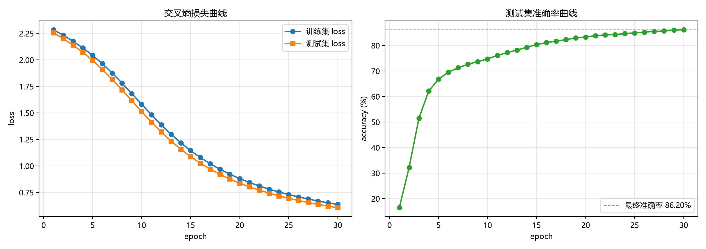
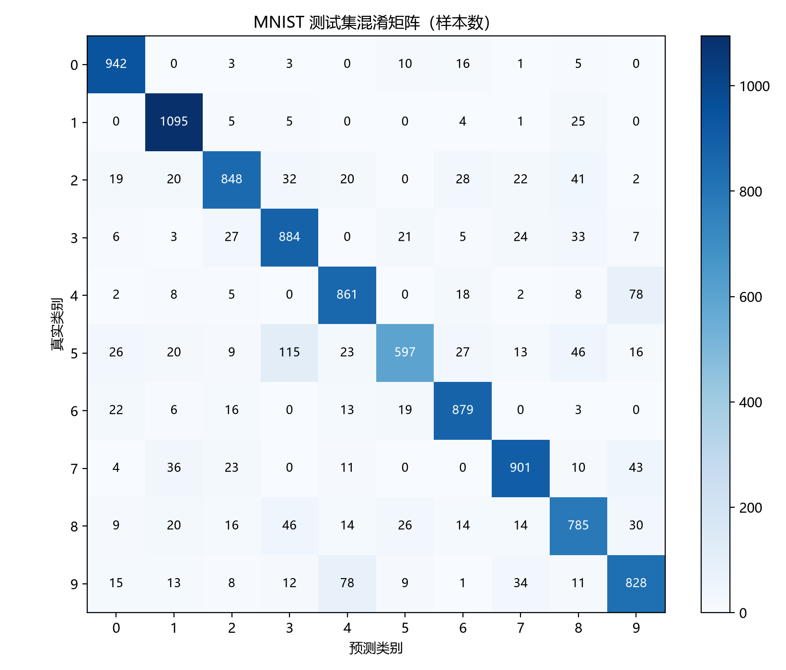
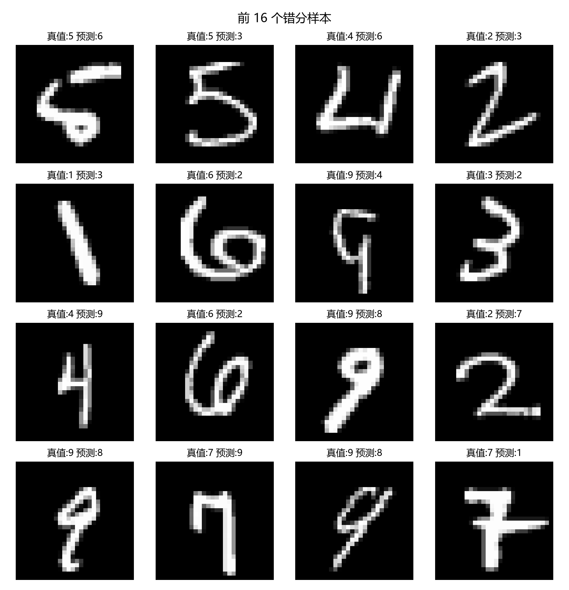

# 计算机视觉实验四：手写数字识别

基于 **PyTorch 手工搭建 MLP（784-128-10）+ 交叉熵损失 + SGD**，在 MNIST 数据集上完成 0~9 十分类，测试集准确率 **86.20%**。

## 效果预览

| 训练曲线 | 混淆矩阵 | 错分样例 |
|:---:|:---:|:---:|
|  |  |  |

## 目录结构

```
.
├── mlp_mnist.py           # 主程序（完整可运行）
├── images/
│   ├── dataset_samples.png    # 数据集样例（0~9 各一例 + 随机 6 例）
│   ├── network_structure.png  # 网络结构示意图
│   ├── loss_acc_curve.png     # 训练/测试 loss 与准确率曲线
│   ├── confusion_matrix.png   # 测试集混淆矩阵
│   ├── correct_samples.png    # 预测正确样例
│   ├── misclassified.png      # 错分样例
│   ├── history.json           # 每轮 loss / accuracy 记录
│   └── mlp_mnist.pt           # 模型权重（运行后生成，未入库）
├── 实验四实验报告.md       # 完整实验报告（原理 / 结果 / 分析）
└── README.md
```

## 环境依赖

```bash
pip install torch torchvision numpy matplotlib
```

## 运行

```bash
python mlp_mnist.py
```

首次运行会自动下载 MNIST 到 `data/`，随后在 `results/` 下生成六张图、`history.json` 与模型权重 `mlp_mnist.pt`，终端同步打印 30 轮逐轮指标。

## 方法流程

1. 加载 MNIST（6 万训练 / 1 万测试），`ToTensor()` 把像素归一到 [0,1]，按 `batch_size=2048` 分批，训练集打乱；
2. 28×28 图像展平为 784 维，经 `nn.Linear(784,128)` + ReLU → `nn.Linear(128,10)` 输出 10 个 logits；
3. `F.cross_entropy` 计算损失（内部含 softmax，故直接传 logits），SGD（lr=0.01）按 `zero_grad → backward → step` 迭代 30 个 epoch；
4. 每个 epoch 结束用 `model.eval()` + `torch.no_grad()` 在测试集评估，记录 loss 与准确率；
5. 统计混淆矩阵与分类别准确率，抽样正确/错分样例，输出六张分析图并保存模型。

## 实验结果

| 指标 | 数值 |
|:---:|:---:|
| 网络结构 | 784 → 128 → 10（101,770 参数） |
| 训练配置 | SGD，lr=0.01，batch=2048，30 epochs |
| 测试集准确率 | **86.20%** |
| 测试集平均交叉熵 | 0.6057 |
| 错分样本 | 1,380 / 10,000 |

准确率最低的是数字 5（66.93%，主要被误判为 3 和 8），4 与 9 存在双向混淆。原因是全连接层把图像拉平后丢失了空间结构，对书写变形不鲁棒。

详细原理、代码注释与结果分析见 [实验四.md](实验四.md)。
