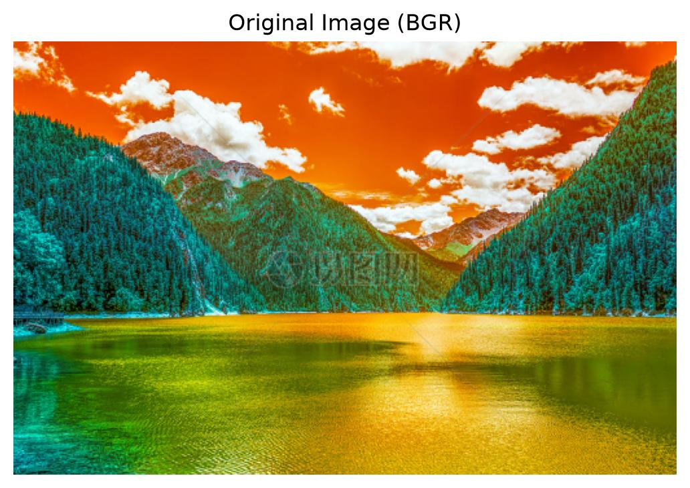
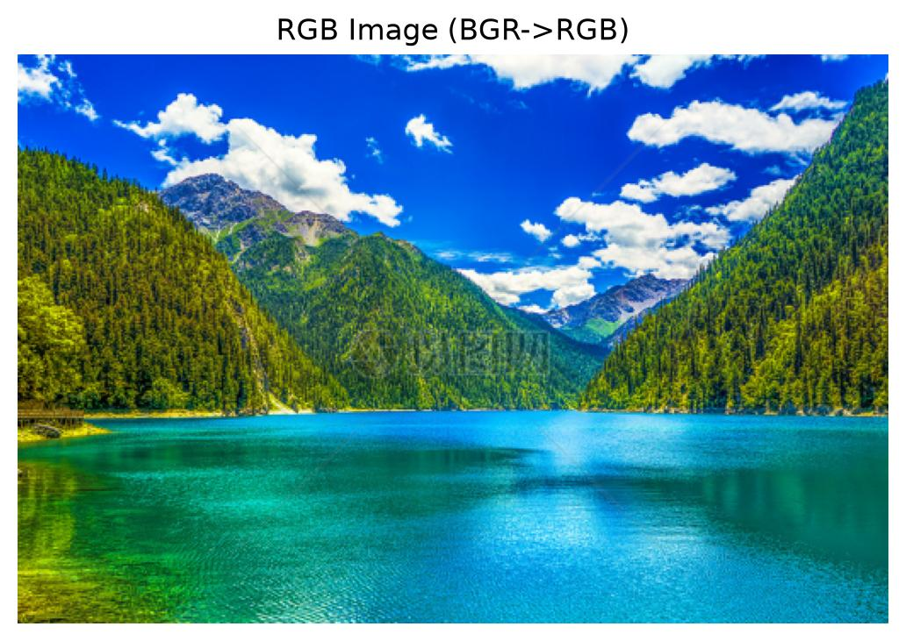
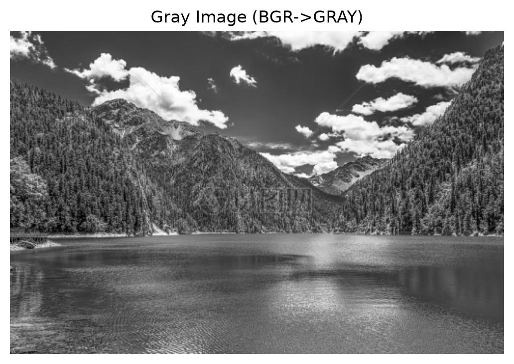
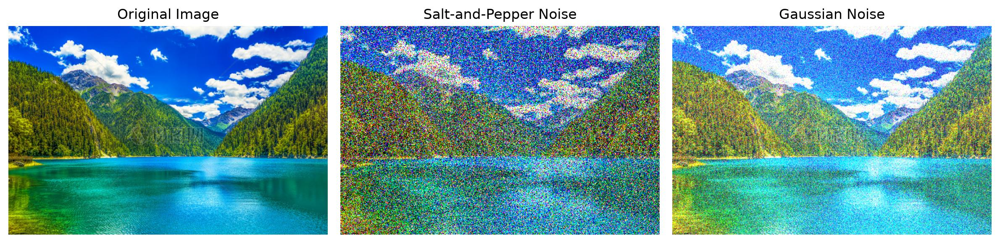
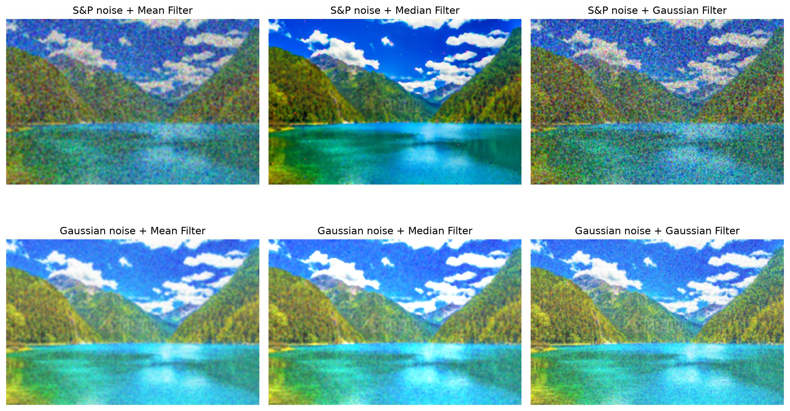
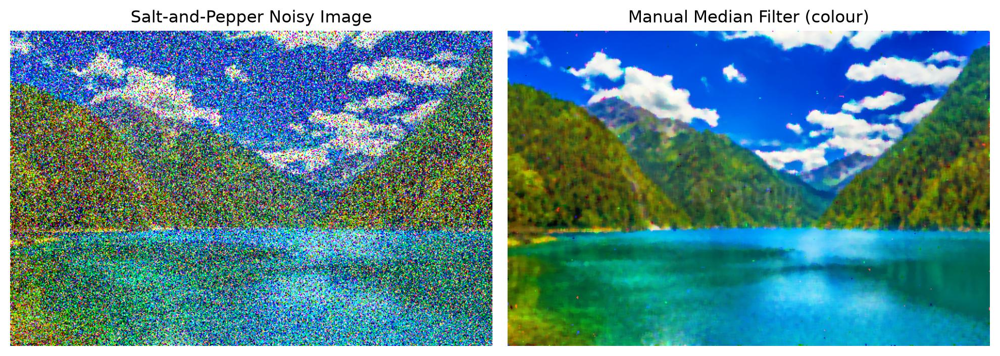

# 实验二：基于 OpenCV 的图像增强

## 一、实验目的

本实验旨在掌握 OpenCV 计算机视觉库的基本使用方法，利用 OpenCV 以及 scikit-image、NumPy、Matplotlib 等计算机库对图像进行平滑、滤波等操作，实现图像增强。具体内容包括：色彩空间转换、向图像添加椒盐噪声与高斯噪声，并分别采用均值滤波、中值滤波和高斯滤波进行去噪，同时手动实现针对彩色图像的分通道中值滤波。

## 二、实验环境

### 2.1 硬件

- 一台 x86-64 个人计算机，用于运行 Python 环境并存放输入 / 输出图像。

### 2.2 软件

- 操作系统：Windows（本地电脑）。
- 编程语言：Python 3.13.16。
- OpenCV（opencv-python）5.0.0——计算机视觉与图像处理。
- scikit-image——图像增强与分析（random_noise 用于添加噪声）。
- NumPy 2.5.4——科学计算基础库。
- Matplotlib——绘图与数据可视化。

## 三、实验原理

### 3.1 色彩空间转换

OpenCV 读取彩色图像后，得到一个形状为 (H, W, 3) 的三维数组，通道顺序为 BGR。使用 `cv2.cvtColor` 可进行色彩空间转换：`cv2.COLOR_BGR2RGB` 交换蓝、红两个通道，使图像以符合人眼认知的 RGB 顺序显示；`cv2.COLOR_BGR2GRAY` 则把三个通道合并为一个灰度（亮度）通道，突出图像的亮度信息。

### 3.2 噪声模型

椒盐噪声以给定的比例（amount）随机将部分像素置为最大值或最小值（白色或黑色），在 RGB 图像中表现为随机的彩色噪点。高斯噪声则对每个像素叠加一个服从高斯分布（给定均值 mean 与方差 var）的随机偏差，作用于整幅图像，影响较为均匀。

### 3.3 空间滤波器

本实验比较三种常用滤波器。均值滤波（`cv2.blur`）用像素 k×k 邻域的算术平均值替代中心像素；高斯滤波（`cv2.GaussianBlur`）以高斯核为权重对邻域加权平均，平滑更自然并保留一定边缘；中值滤波（`cv2.medianBlur`）用邻域中值替代中心像素，对孤立的椒盐噪点尤其有效。

### 3.4 彩色图像的手动中值滤波

为加深对滤波原理的理解，手动实现中值滤波。由于三个颜色通道相互独立，算法对 R、G、B 三个通道分别处理：对每个像素，取其 k×k 邻域窗口（边缘用零填充）的中值作为该位置的新值。

## 四、实验内容与步骤

### 4.1 导入依赖库

首先导入 OpenCV、scikit-image、NumPy 与 Matplotlib，并创建输出文件夹。为使结果能直接保存为图片文件，将 Matplotlib 后端设置为非交互模式。

### 4.2 读取原始图像与色彩空间转换

读取本地图像 `p1.jpg`（高山湖泊自然风光图），并按原宽高比缩放到长边为 512 像素，实际尺寸为 512×335。随后读取位于 (行, 列) = (100, 100) 处像素的 BGR 值，输出为 **31, 87, 77**，呈偏绿色调，属于画面中山林植被区域。原始 BGR 图、BGR→RGB 转换图和 BGR→GRAY 灰度图分别如图 1、图 2 和图 3 所示。



**图 1 原始图像（BGR 通道顺序）**



**图 2 BGR→RGB 转换后的图像（蓝红通道互换）**



**图 3 灰度图（BGR→GRAY）**

### 4.3 添加噪声

在 RGB 图像基础上生成两幅带噪图像：椒盐噪声（amount = 0.4）和高斯噪声（mean = 0.2，var = 0.03）。原始图像与两种带噪图像的对比如图 4 所示。



**图 4 原始图像、椒盐噪声与高斯噪声对比**

### 4.4 图像滤波

对两幅带噪图像分别进行均值滤波（5×5）、中值滤波（核大小为 5）和高斯滤波（5×5）。中值滤波与高斯滤波要求输入为 uint8，因此将浮点带噪图像乘以 255 后转为 uint8。2×3 网格的滤波结果如图 5 所示。



**图 5 滤波结果：第 1 行为椒盐噪声，第 2 行为高斯噪声；各列依次为均值、中值和高斯滤波**

### 4.5 手动实现中值滤波

函数 `manual_median_filter_color` 通过逐通道独立处理实现彩色图像中值滤波。将其作用于椒盐带噪图像（核大小为 5），并与带噪输入对比，结果如图 6 所示。



**图 6 椒盐噪声图像（左）与手动中值滤波结果（右）对比**

## 五、实验结果与分析

### 5.1 原始图像与色彩空间转换

原始彩色图像被正确读取和显示。BGR→RGB 转换后颜色更符合人眼认知，红、绿、蓝通道正确对应；灰度图则突出图像的亮度信息，便于后续基于强度的图像处理分析。

### 5.2 噪声添加效果

椒盐噪声在图像中随机产生孤立的白、黑（RGB 图中为彩色）噪点，对局部区域破坏明显；高斯噪声对每个像素叠加均匀的随机偏差，使整幅图像亮度轻微抖动、细节略有模糊。相比之下，椒盐噪声的局部破坏更明显，而高斯噪声影响全局视觉效果。

### 5.3 滤波去噪效果

由滤波对比结果可以得出以下结论。均值滤波能够较好地平滑整幅图像、有效去除高斯噪声，但对椒盐噪声中尖锐的黑白噪点去除不彻底，且容易造成边缘模糊。中值滤波对椒盐噪声的去除效果显著，能有效保留图像边缘和细节，对高斯噪声也有一定抑制作用，但整体去噪效果略逊于均值滤波。高斯滤波对高斯噪声的去除效果最佳，平滑自然且保留一定边缘，但对突变型椒盐噪声的处理能力有限。

### 5.4 手动中值滤波

手动实现的分通道中值滤波效果与 OpenCV 内置 `medianBlur` 基本一致：能有效去除孤立的椒盐噪点，同时保持颜色真实、边缘清晰，验证了彩色图像应分别对 R、G、B 三通道独立滤波的合理性。

总体而言，不同噪声类型适合采用不同的滤波方法：椒盐噪声属于突变型噪声，中值滤波能够有效去除孤立黑白噪点并保留边缘细节，最为合适；高斯噪声属于连续型噪声，采用均值滤波或高斯滤波进行平滑更自然。手动实现不仅复现了 OpenCV 的滤波效果，也加深了对滤波原理的理解。

## 六、实验小结

本实验完成了彩色图像的读取、BGR→RGB 与 BGR→GRAY 转换，并向图像添加了椒盐噪声与高斯噪声；随后分别采用均值滤波、中值滤波以及手动实现的中值滤波进行去噪，比较了不同滤波方法的效果。结果表明：中值滤波对椒盐噪声的去除效果最为显著且能保留边缘细节；均值滤波更适用于高斯噪声的平滑去除；手动实现的中值滤波在处理彩色图像时同样表现良好，既能抑制噪声又能保持真实色彩与结构信息。通过本次实验，加深了对图像噪声类型与滤波原理的理解，为后续图像去噪与滤波算法的改进奠定了基础。

---

## 附录 A：完整源代码

下方为本次实验完整、可直接运行的 Python 脚本。依赖库：`opencv-python`、`scikit-image`、`numpy`、`matplotlib`。运行方式：`python experiment2_image_enhancement.py`

```python
"""
Experiment 2: Image Enhancement Based on OpenCV
=================================================
Course     : Digital Image Processing (Shanghai Maritime University)
Objective  : Master the basic usage of OpenCV, and use computer-vision
             libraries to perform smoothing / filtering operations on
             images so as to achieve image enhancement.
Dependencies: opencv-python, scikit-image, numpy, matplotlib
Run        : python experiment2_image_enhancement.py
"""

import os
import matplotlib
matplotlib.use('Agg')          # non-interactive backend (no GUI required)
import cv2
import numpy as np
from skimage.util import random_noise
from matplotlib import pyplot as plt

os.makedirs('output_images', exist_ok=True)
os.makedirs('result', exist_ok=True)

# ---- 4.2 Read the original image and convert colour spaces ----
img = cv2.imread('p1.jpg')
h, w = img.shape[:2]
scale = 512 / max(h, w)
img = cv2.resize(img, (int(w * scale), int(h * scale)),
                 interpolation=cv2.INTER_AREA)

(b, g, r) = img[100, 100]
print('Pixel (100, 100) -> BGR =', b, g, r)

plt.imshow(img)
plt.title('Original Image (BGR)')
plt.axis('off')
plt.savefig('output_images/original_bgr.jpg', dpi=200, bbox_inches='tight')
plt.close()

rgb_img = cv2.cvtColor(img, cv2.COLOR_BGR2RGB)
plt.imshow(rgb_img)
plt.title('RGB Image (BGR->RGB)')
plt.axis('off')
plt.savefig('output_images/rgb_image.jpg', dpi=200, bbox_inches='tight')
plt.close()

gray_img = cv2.cvtColor(img, cv2.COLOR_BGR2GRAY)
plt.imshow(gray_img, cmap='gray')
plt.title('Gray Image (BGR->GRAY)')
plt.axis('off')
plt.savefig('output_images/gray_image.jpg', dpi=200, bbox_inches='tight')
plt.close()

# ---- 4.3 Add noise ----
sp_noise_img = random_noise(rgb_img, mode='s&p', amount=0.4)
gus_noise_img = random_noise(rgb_img, mode='gaussian', mean=0.2, var=0.03)

plt.figure(figsize=(12, 4))
plt.subplot(1, 3, 1); plt.imshow(rgb_img, cmap='gray')
plt.title('Original Image'); plt.axis('off')
plt.subplot(1, 3, 2); plt.imshow(sp_noise_img, cmap='gray')
plt.title('Salt-and-Pepper Noise'); plt.axis('off')
plt.subplot(1, 3, 3); plt.imshow(gus_noise_img, cmap='gray')
plt.title('Gaussian Noise'); plt.axis('off')
plt.tight_layout()
plt.savefig('output_images/noise_comparison.jpg', dpi=200, bbox_inches='tight')
plt.close()

# ---- 4.4 Image filtering ----
mean_sp = cv2.blur(sp_noise_img, (5, 5))
mean_gus = cv2.blur(gus_noise_img, (5, 5))

mid_sp = cv2.medianBlur((sp_noise_img * 255).astype(np.uint8), 5)
mid_gus = cv2.medianBlur((gus_noise_img * 255).astype(np.uint8), 5)

gauss_sp = cv2.GaussianBlur((sp_noise_img * 255).astype(np.uint8), (5, 5), 0)
gauss_gus = cv2.GaussianBlur((gus_noise_img * 255).astype(np.uint8), (5, 5), 0)

plt.figure(figsize=(13, 8))
plt.subplot(2, 3, 1); plt.imshow(mean_sp); plt.title('S&P noise + Mean Filter'); plt.axis('off')
plt.subplot(2, 3, 2); plt.imshow(mid_sp); plt.title('S&P noise + Median Filter'); plt.axis('off')
plt.subplot(2, 3, 3); plt.imshow(gauss_sp); plt.title('S&P noise + Gaussian Filter'); plt.axis('off')
plt.subplot(2, 3, 4); plt.imshow(mean_gus); plt.title('Gaussian noise + Mean Filter'); plt.axis('off')
plt.subplot(2, 3, 5); plt.imshow(mid_gus); plt.title('Gaussian noise + Median Filter'); plt.axis('off')
plt.subplot(2, 3, 6); plt.imshow(gauss_gus); plt.title('Gaussian noise + Gaussian Filter'); plt.axis('off')
plt.tight_layout()
plt.savefig('result/filter_results_2x3.jpg', dpi=200, bbox_inches='tight')
plt.close()

# ---- 4.5 Manual median filter (colour, per channel) ----
def manual_median_filter_color(image, kernel_size=5):
    pad = kernel_size // 2
    filtered_img = np.zeros_like(image)
    for c in range(3):                      # process R, G, B independently
        channel = image[:, :, c]
        padded_channel = np.pad(channel, pad_width=pad, mode='edge')
        for i in range(channel.shape[0]):
            for j in range(channel.shape[1]):
                region = padded_channel[i:i + kernel_size, j:j + kernel_size]
                filtered_img[i, j, c] = np.median(region)
    return filtered_img

manual_mid = manual_median_filter_color(
    (sp_noise_img * 255).astype(np.uint8), kernel_size=5
)

plt.figure(figsize=(10, 5))
plt.subplot(1, 2, 1); plt.imshow(sp_noise_img, cmap='gray')
plt.title('Salt-and-Pepper Noisy Image'); plt.axis('off')
plt.subplot(1, 2, 2); plt.imshow(manual_mid, cmap='gray')
plt.title('Manual Median Filter (colour)'); plt.axis('off')
plt.tight_layout()
plt.savefig('result/manual_median.jpg', dpi=200, bbox_inches='tight')
plt.close()

print('All result images have been saved to ./output_images and ./result')
```
